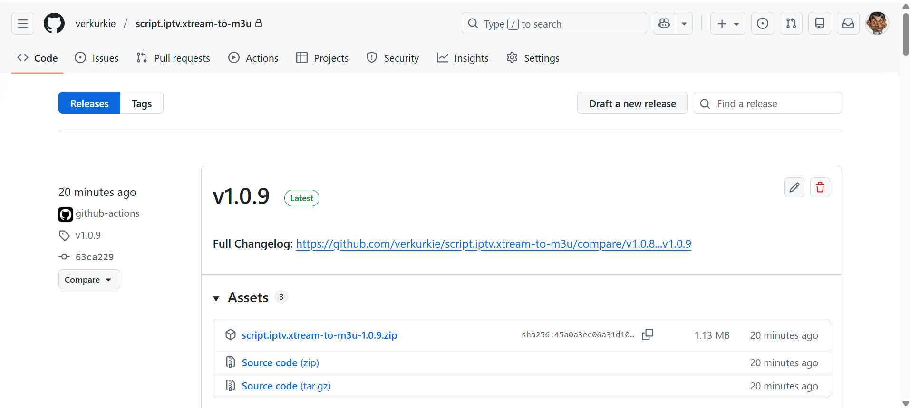
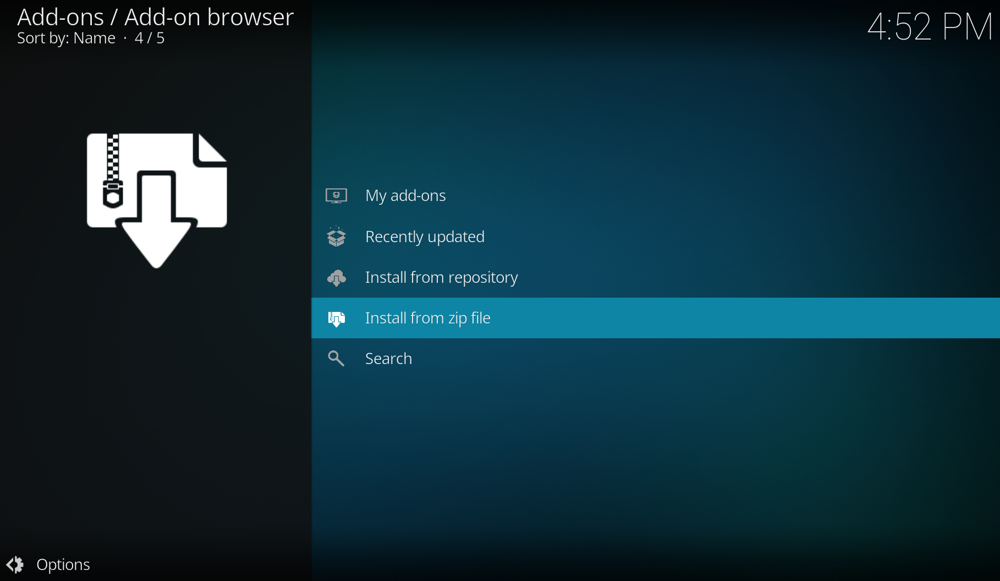
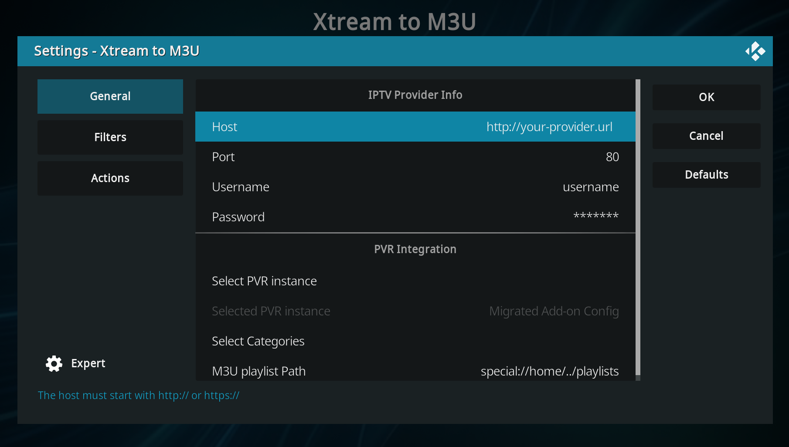
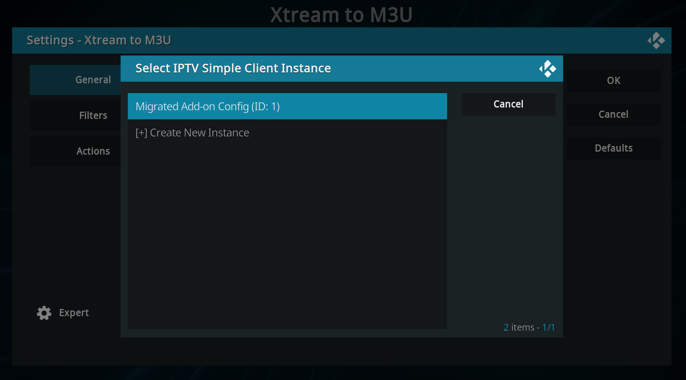
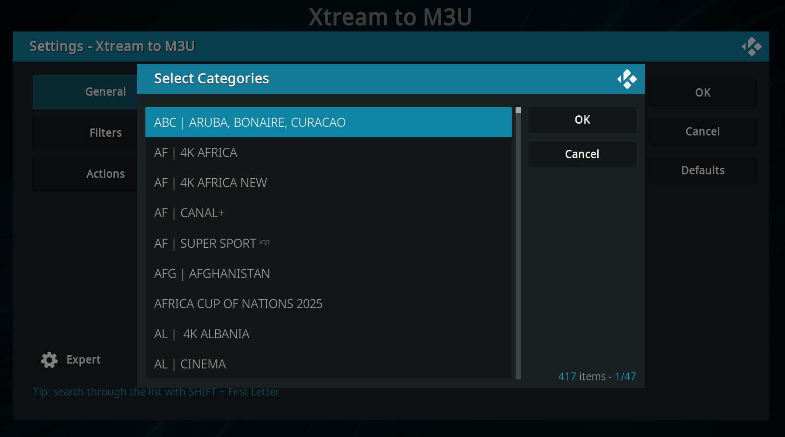
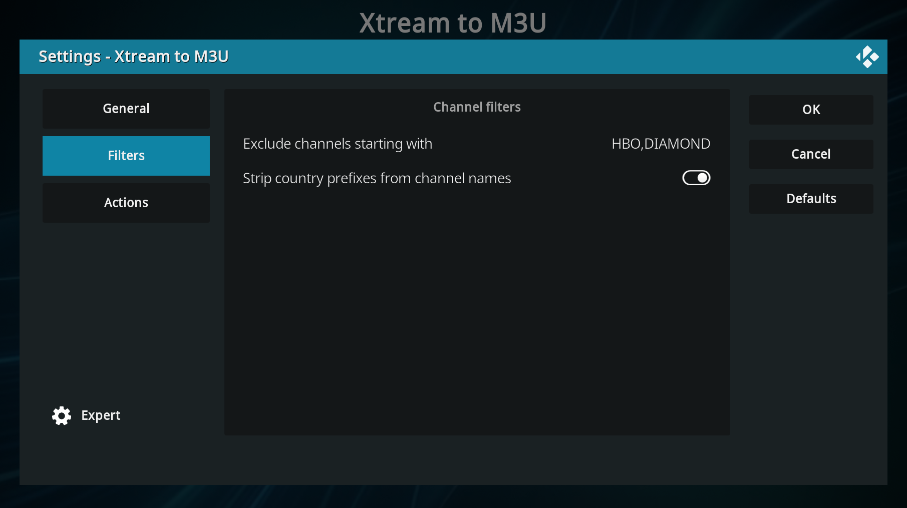
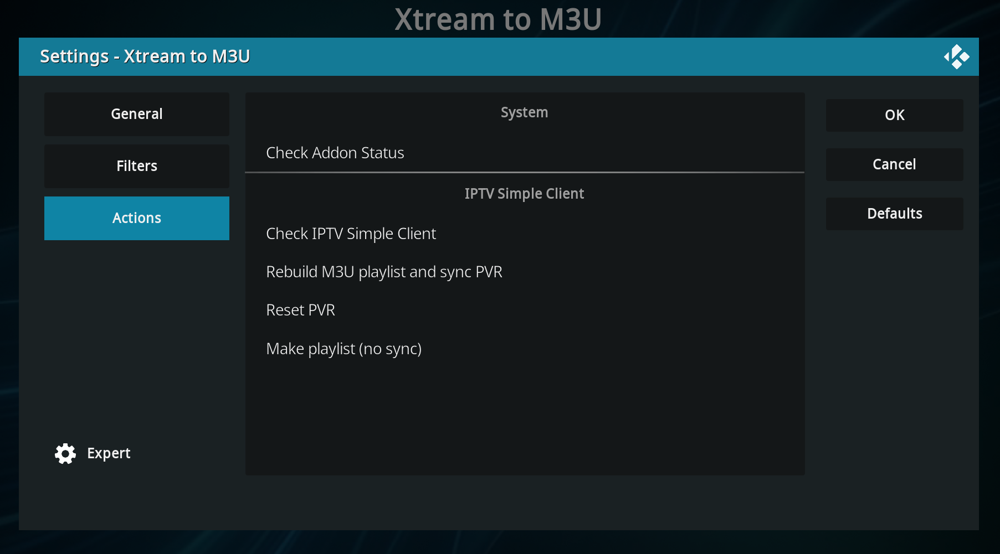
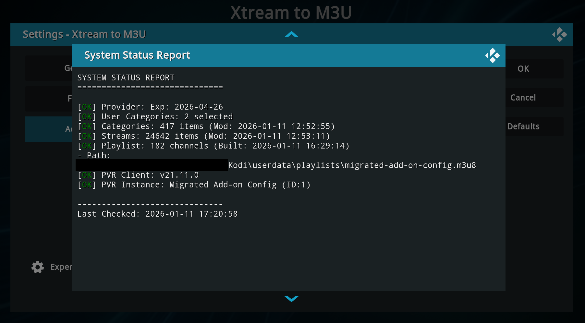

# Installation and Configuration <!-- omit in toc -->

This document helps you install and configure the addon.

## Table of contents <!-- omit in toc -->

- [Installation](#installation)
- [Configuration](#configuration)
  - [General](#general)
      - [General -\> PVR Instance](#general---pvr-instance)
      - [General -\> Select Categories](#general---select-categories)
  - [Filters](#filters)
  - [Actions](#actions)
- [Test it](#test-it)

## Installation

To install the add-on, follow these steps:

1. Download the latest ZIP file from the [releases page](https://github.com/verkurkie/script.iptv.xtream-to-m2u/releases)

   

2. Install the addon in Kodi via the addon manager (using the "Install from zip file" option)

   ❗ If you see a message about installing from unknown source, enable it in Kodi settings before installing!

   

## Configuration

Assuming the installation went well, you can now start the add-on configuration!

- In Kodi, go to System Settings -> Add-ons -> My add-ons -> Program add-ons -> Xtream to M3U
- Make sure the add-on is enabled
- Click on "Configure"

### General

- ❗ **Important: You must enter & save your Xtream IPTV credentials on the first run!**
  - Without this, the addon will not function.

  

##### General -> PVR Instance

Once you have set your credentials and saved them, return to the configuration screen and select a PVR instance to use. This is an existing configuration in the IPTV Simple Client add-on.

- ℹ️ If IPTV Simple Client is not installed, the addon will ask you to install it.

  

##### General -> Select Categories

After selecting a PVR instance, you can start selecting your desired TV Channel Categories.

- ℹ️ On first run, the add-on will fetch categories from your Xtream IPTV account and display them here. You can select multiple categories to convert to M3U.

- ℹ️ When you select "OK" to save your selection, the add-on will convert your selection to an M3U playlist file and configure it in the IPTV Simple Client instance you selected.

- 💡 **Tip**: You can "jump" through the list of categories by simultaneously pressing `SHIFT` and any letter -> it will jump to the first category that starts with that letter.

  

### Filters

Filters can be used to further fine-tune your playlist. Your have the following options:

- **Exclude channels starting with**
  - example: if you don't want channels that start with `"HBO"` or `"ESPN"`, enter `"HBO,ESPN"` here
- **Strip country prefixes from channel names**
  - when this option is selected, the add-on will remove country prefixes (like `"US | "` -> `"UK | "`) from channel names

  

### Actions

The "Actions" tab is where you can find the add-on status and perform actions that normally require a restart of Kodi. The following actions are available:

- **Check Addon Status**
  - this will check the addon display the status
- **Check IPTV Simple Client**
  - this will check if IPTV Simple Client is installed and enabled and display the status
- **Rebuild M3U playlist and sync PVR**
  - this will rebuild your M3U playlist, (re-)configure your IPTV Simple Client instance and reload the PVR instance
- **Make playlist (no sync)**
  - this will only rebuild your M3U playlist (so you can inspect it)

  

  

## Test it

Once you have gone through configuring the add-on, make sure you always click on OK!
Then, head over to the "TV" section of Kodi and check if your groups/channels are there.

🎉 Happy Kodi'ing!

